# A few of the app's screens

A hand-picked few, for a reader of the repository who wants to see the app: each is a preview's compact window
(412 × 915 dp at font scale 1.0), light and dark, copied byte for byte from `docs/app-shots`, which
`scripts/app_shots.sh` writes from a green `./gradlew recordRoborazziDebug` and which git does not track. The
whole set, every preview, is CI's `app-shots` artifact on each run. These were copied from the record at
`aca4c1c`, whose screens `7f995e8` left unchanged, all but the thinking card's and the Instance screen's, which
Task 23 moved and copied from the record of the part that moved each: the card's verb and halo, and the Instance
screen's new layout. When a change moves one of these previews, the change copies the new image here by the same
name, so the few stay the screens as they are (AGENTS.md, Screenshots).

| Screen | Preview | Light | Dark |
|---|---|---|---|
| Welcome: the mark, the wordmark and the two actions | `WelcomePreview` | 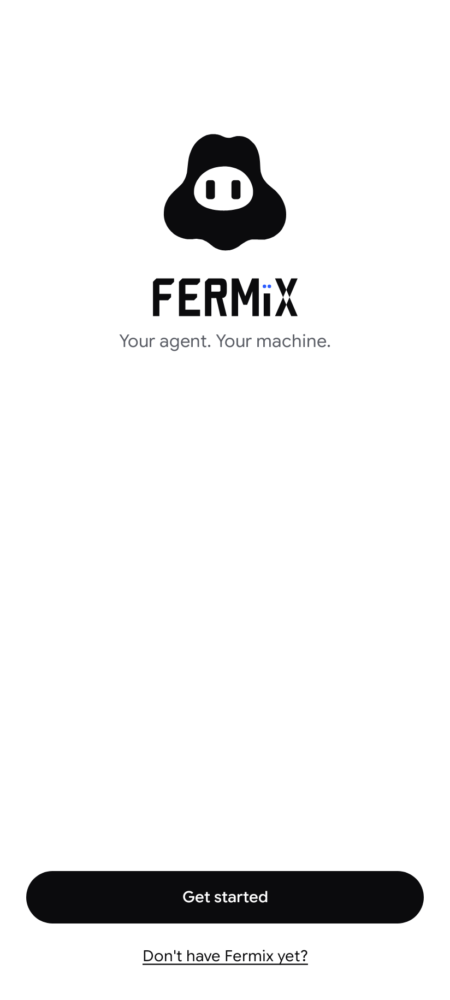 | 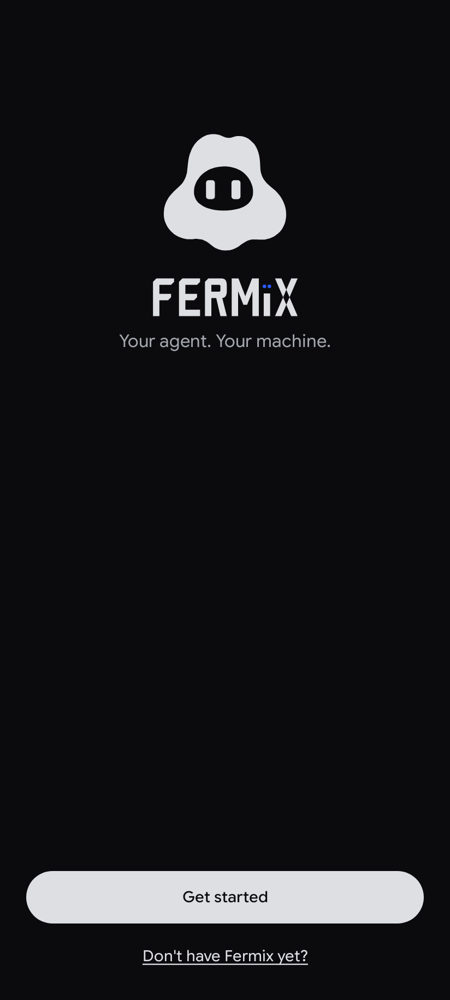 |
| Verify: the six-digit code to match on the computer, with its countdown | `VerifyPreview` | 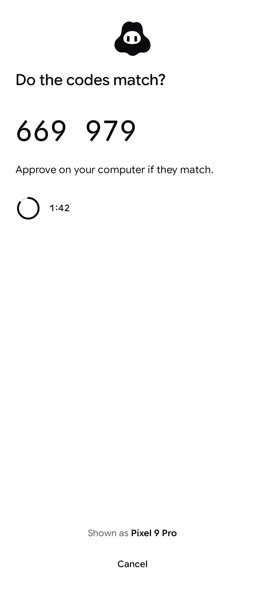 | 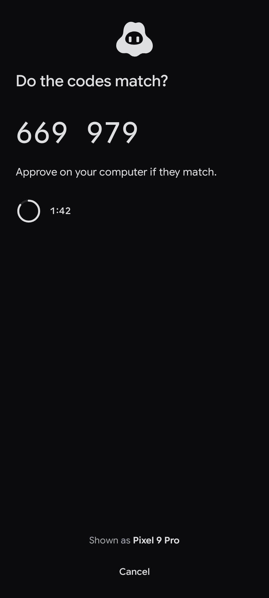 |
| Paired: the mark's happy eyes | `PairedPreview` | 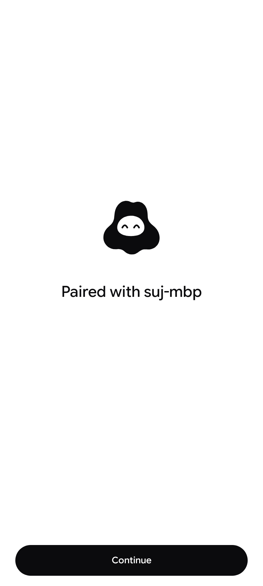 | 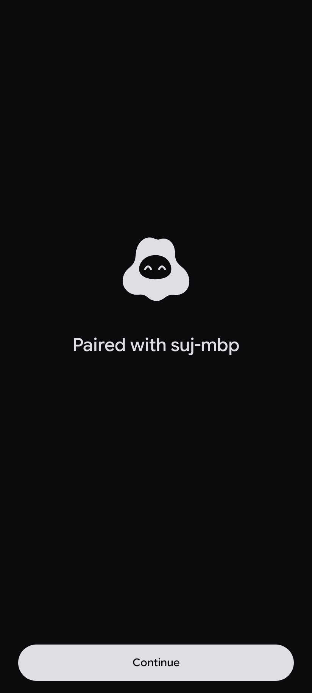 |
| The Chats list: a row per paired Fermix, the unread count in Fermix blue, a DEV tag, a revoked row | `ChatsListPreview` | 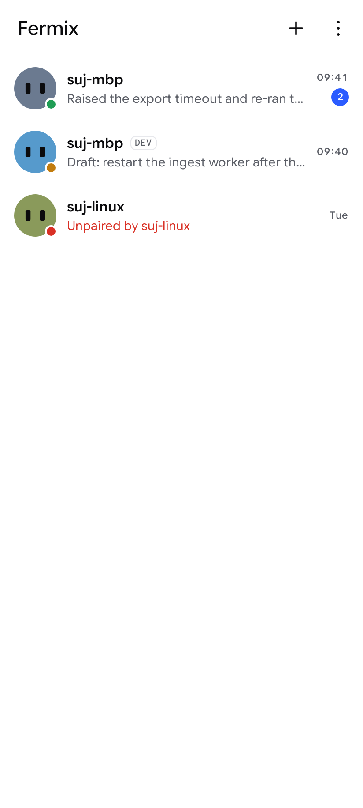 | 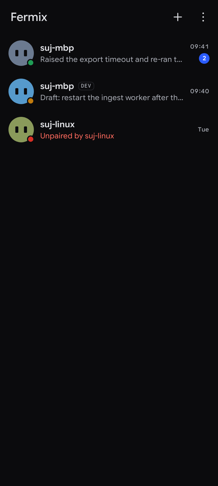 |
| A chat: the owner's bubbles in the ink, the agent's on its tone, the unread divider, the scroll-to-latest pill | `ThreadPreview` | 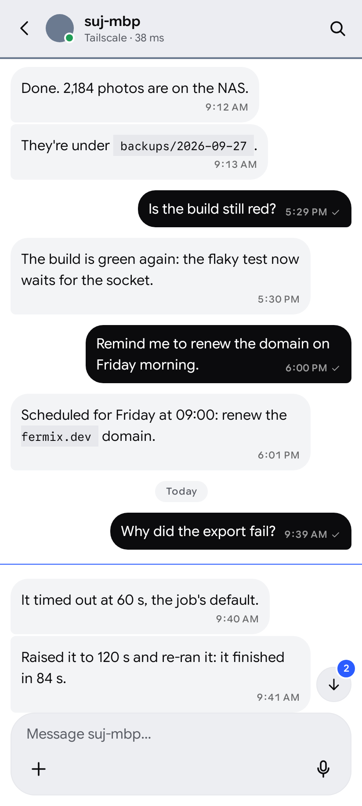 | 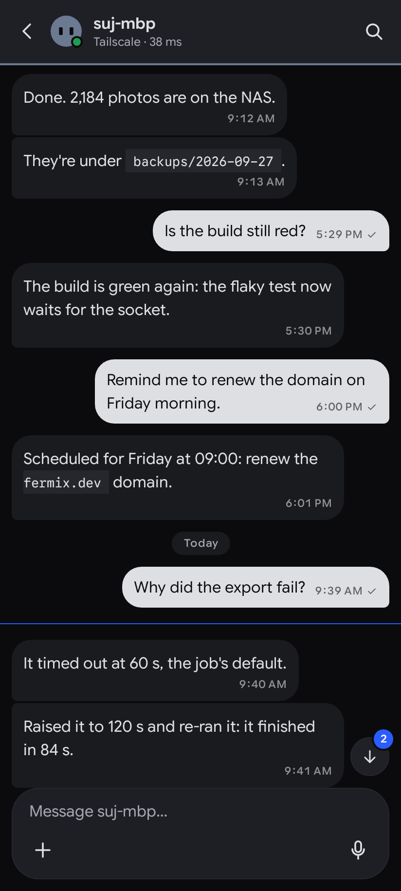 |
| The thinking card: the two-dot mark, the daemon's headings and its tool chips | `ThinkingPreview` | 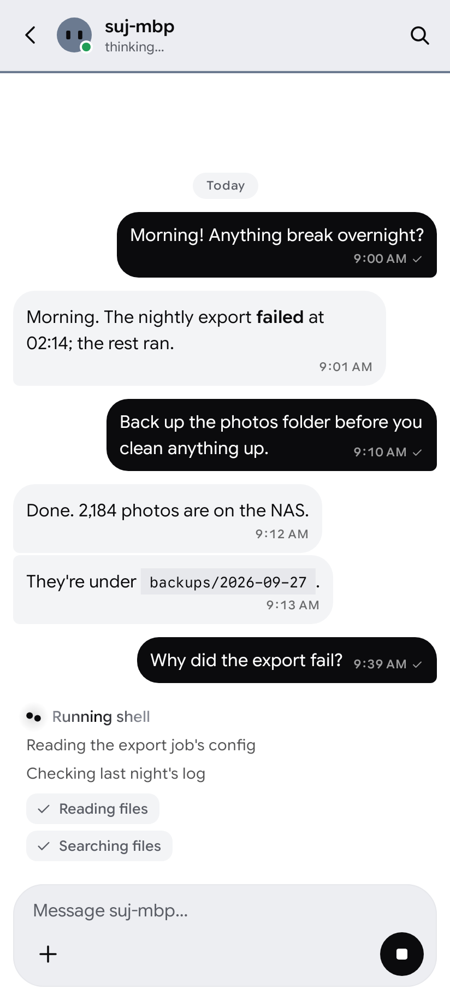 | 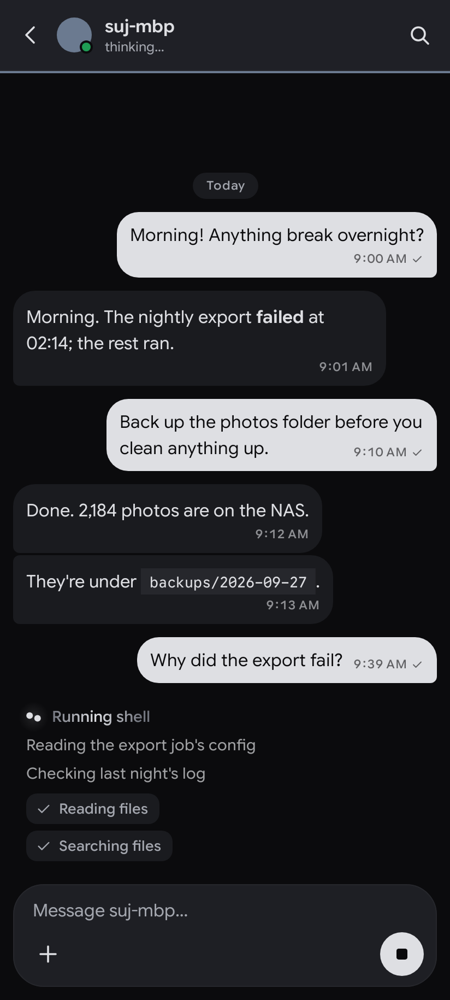 |
| An approval card with its countdown, and the model chip in the composer | `ApprovalPreview` | 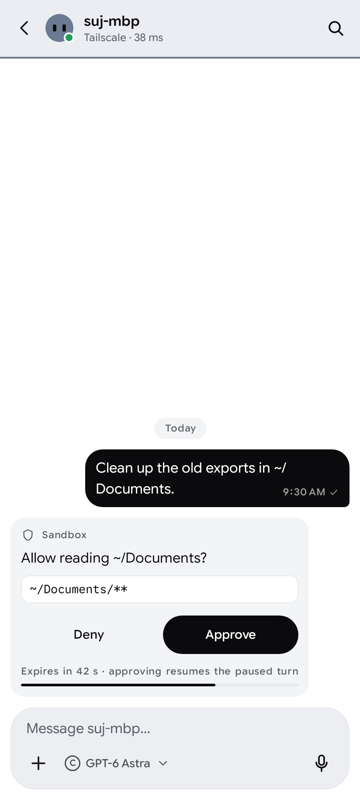 | 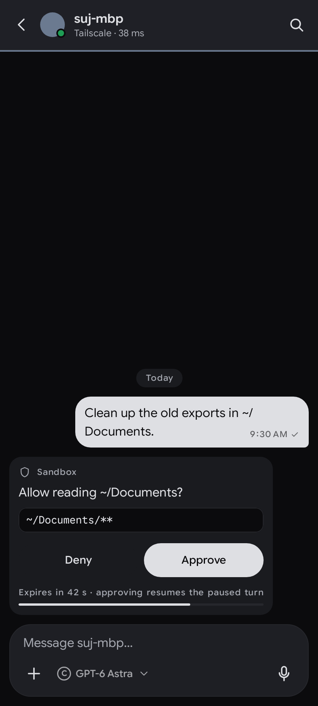 |
| The Instance screen: what the phone holds of one Fermix | `InstanceScreenPreview` | 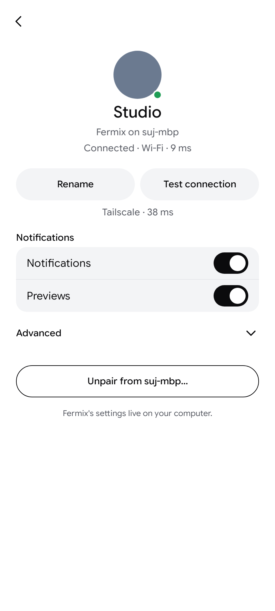 | 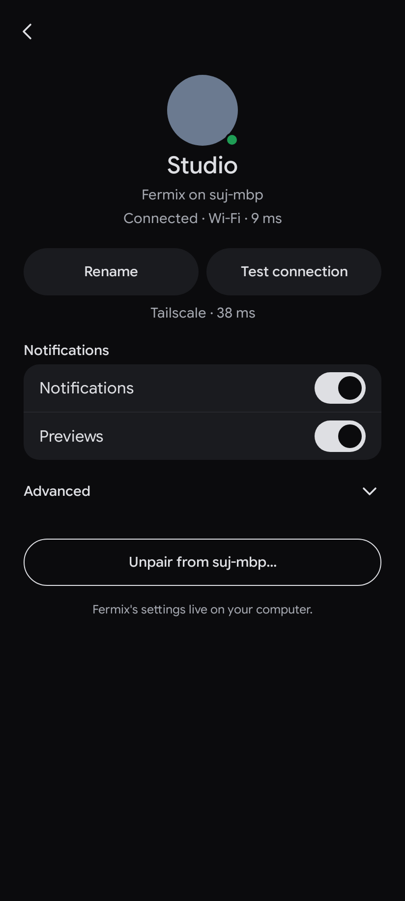 |
